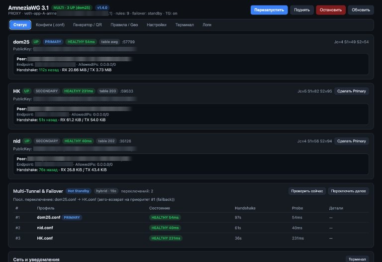
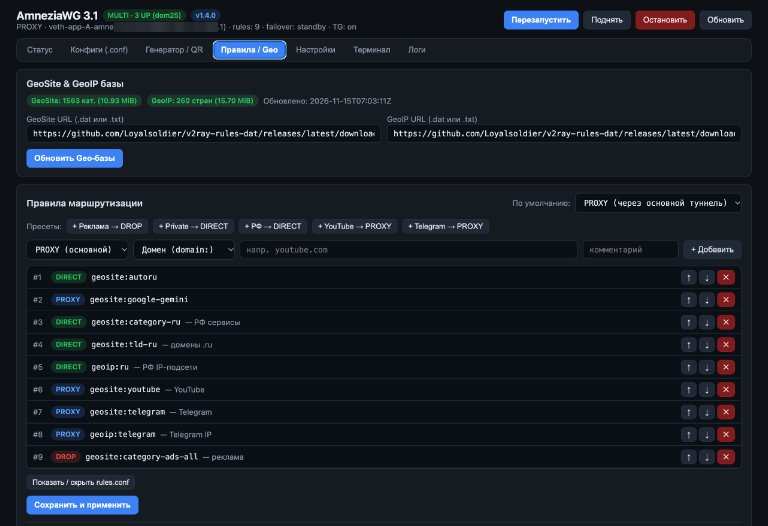
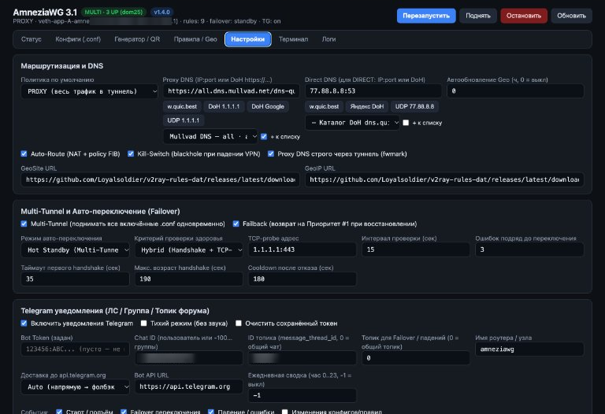

# A-amneziawg-mikrotik

Клиент и сервер **AmneziaWG 3.1** (`amneziawg-go v3.1.20260828` + `awg-quick v3.1.20260812`) для **MikroTik RouterOS (`/app`)** с современным **WebUI (`:8092`)**, одновременной работой нескольких туннелей (**Multi-Tunnel**), автоматическим переключением (**Auto-Failover**), маршрутизацией по **GeoSite / GeoIP**, встроенным **DoH DNS-форвардером (`:53`)**, **Telegram-уведомлениями** и 4-режимной синхронизацией с **RouterOS (Binary API `:8728/:8729`, REST API, Address-List + Mangle, BGP)**.

- **Образ:** `ghcr.io/aligorov/routeros-aligorov/amneziawg-mikrotik:1` (`v1.7.7`, `linux/arm64`, `linux/amd64` для CHR, `linux/arm/v7`)
- **WebUI:** `http://<ip-роутера>:8092` (кнопка **Open WebUI** в Winbox)
- **Сеть:** `/app` автоматически создаёт выделенный `veth` (без ручной подготовки интерфейсов)
- **Том:** `awg-config` → `/etc/amnezia/amneziawg` (`*.conf`, `.active`, `settings.json`, `rules.conf`, `geo/`, `domains.txt`, `ros-dynamic.json`)
- **Порты:** `8092:8080/tcp` (WebUI), `51821:51820/udp` (AWG Server), внутри контейнера также `:53/udp+tcp` (DNS) и `:8081/tcp` (health-зонд туннеля)

---

## Возможности (v1.7.7)

- **Dynamic Dual-Stack IPv6 (Zero-Hardcode)** — полноценная поддержка IPv6-эндпоинтов на MikroTik RouterOS без ручного хардкода: автоматический приём SLAAC Router Advertisements (`accept_ra=2`), автогенерация детерминированного ULA IPv6 (`fd00:<ipv4>::/64`) из IPv4 подсети veth, автопровижининг IPv6-шлюза на RouterOS, правил маршрутизации `/ipv6/route`, IPv6 NAT Masquerade и mangle-правил, а также изоляция сбоев туннелей без повреждения соседних таблиц маршрутизации.

- **Управление VPS (`awg-manager`), клиентами, маскировкой (12 UDP-протоколов) и авто-рассылкой в Telegram** — единый список VPS-серверов (подключение по Admin API токену `awg_adm_*` по HTTPS на `:8443`) и единый реестр клиентов на вкладке «VPS и клиенты»: создание, редактирование (имя, `DNS`, `MTU`, `AllowedIPs`, индивидуальный `Endpoint IPv4/IPv6/домен`, `rekey`, смена токена), удаление, показ актуального QR / `.conf` / `vpn://`, смена внешнего Endpoint VPS (`IPv4`/`IPv6`/домен), смена маскировки (`QUIC`, `QUIC Alt`, `WebRTC/STUN`, `DTLS 1.2`, `DNS`, `NTP`, `SIP`, `Steam`, `Minecraft`, `Discord`, `BitTorrent DHT`, `Custom`) и полная ротация. При любых изменениях или ротации на VPS контейнер автоматически синхронизирует свои туннели и рассылает обновлённый QR + `.conf` + `vpn://` привязанным пользователям через бота контейнера.

- **Авто-ротация сервера и токены подписок (Subscription API :8443)** — для каждого подключения на вкладке «Статус» и «Настройки» задаётся постоянный токен клиента (`awg_tok_...`) и порт API подписки сервера (по умолчанию `8443`). При смене UDP-порта, ключей или обфускации на сервере (например, при блокировках ТСПУ) клиент подтягивает новый конфиг автоматически по расписанию (15м, 30м, 1ч, 3ч, 6ч, 12ч, 1д, 3д, 7д) или мгновенно при потере связи (**Failover-sync** при переходе в `UNHEALTHY`) без разрыва туннеля. Кэширование `ETag` и `304 Not Modified` экономит трафик и ресурсы.
- **Multi-Tunnel и приоритеты профилей** — загрузка любого числа `.conf` (drag-and-drop в браузере), порядок приоритетов (`#1` — Primary), одновременный подъём нескольких туннелей в отдельных таблицах (`awg`, `202+`, `210`), проверка конфликтов подсетей `Address` и переключение Primary в один клик.
- **Auto-Failover (`Cold Switch` и `Hot Standby`)** — контроль здоровья каждого профиля по `Hybrid` (`Handshake + Probe`), только `Handshake` или только `Probe` (`TCP connect`, реальный **ICMP Ping** через интерфейс/fwmark или комбинированные `any`/`both`); настройка интервала, порога ошибок, cooldown, авто-возврат (**Failback**) на приоритет `#1` и интерактивная проверка **Ping хоста (HEALTHY)** через все активные туннели + `Direct` прямо со вкладки статуса.
- **Правила маршрутизации и GeoSite / GeoIP** — поддержка баз `geosite.dat` и `geoip.dat` (по умолчанию из `Loyalsoldier/v2ray-rules-dat`) с автообновлением по расписанию; политика по умолчанию (`PROXY` / `DIRECT`), правила `PROXY` (основной или конкретный туннель `PROXY:<iface>`), `DIRECT`, `DROP`, готовые пресеты (Реклама → `DROP`, РФ → `DIRECT`, YouTube/Telegram → `PROXY`) и проверка маршрута для любого домена или IP.
- **DNS-форвардер + DoH (RFC 8484)** — локальный DNS на `:53` (UDP/TCP), раздельные **Proxy DNS** (строго через туннель с `fwmark`) и **Direct DNS**, плюс встроенный каталог из **179 DoH-серверов** (`dns.quic.best`, включая `w.quic.best`) с поддержкой fallback-цепочек.
- **Telegram-уведомления** — отправка алертов о старте, failover-переключениях, падениях и ежедневной сводки в ЛС, группу или топик форума (`message_thread_id`, с отдельным топиком для критических алертов); маршрут доставки до `api.telegram.org` (`Auto` / напрямую / через туннель) и поддержка зеркала Bot API.
- **Генератор / QR, Web-терминал и Логи** — генерация ключей и параметров обфускации AWG 3.1 (`Jc`, `S1`, `S2`), экспорт клиентских конфигов и QR-кодов, встроенный shell-терминал (`awg show`, `ip route`, диагностика) и полноэкранный просмотр логов с фильтром.
- **Интеграция с RouterOS (4 режима работы)** — health-эндпоинт `:8081` для `/tool/netwatch`, выбор режима `ROS_MODE` прямо в WebUI (`gateway` / `address_list` / `bgp` / `manual`), основной транспорт через MikroTik Binary API (`:8728` / TLS `:8729`) с автофоллбэком на REST API, а также проверка и пошаговый автопровижининг обвязки на роутере (`GET /api/ros/schema`, `POST /api/ros/provision`).

---

## Интерфейс

### Статус туннелей, Multi-Tunnel и Failover


### Правила маршрутизации и GeoSite / GeoIP


### Настройки DNS (DoH), Failover и Telegram-уведомлений


---

## Установка и обновление

1. В **Winbox → App → App** нажмите **Update** (обновить каталог стора).
2. Выберите **`A-amneziawg-mikrotik`** и нажмите **Enable**.
   > Для принудительного обновления уже установленного контейнера под тем же тегом `:1`:
   > ```routeros
   > /app/disable A-amneziawg-mikrotik; /app/remove A-amneziawg-mikrotik; /app/cleanup; /app/enable A-amneziawg-mikrotik
   > ```
3. Откройте **Open WebUI** (`http://<ip-роутера>:8092`):
   - **Конфиги (.conf)** — загрузите или вставьте один или несколько `.conf`, задайте приоритет.
   - **Правила / Geo** — загрузите Geo-базы и при необходимости выберите пресеты (`РФ → DIRECT`, `Реклама → DROP` и др.).
   - **Настройки** — укажите Proxy/Direct DNS (или выберите из каталога DoH), настройте `Multi-Tunnel`, `Failover`, `Telegram` и `ROS_URL`.
   - *Без WebUI:* передайте конфиг в переменной `AWG_CONF_B64` (base64) или поместите `*.conf` в том `awg-config`.

---

## Выборочная маршрутизация в RouterOS (опционально)

Чтобы заворачивать в контейнер только нужные подсети/списки устройств с роутера, можно импортировать скрипт [`router-setup.rsc`](router-setup.rsc):

```routeros
/tool fetch url="https://aligorov.github.io/routeros-aligorov/apps/a-amneziawg-mikrotik/router-setup.rsc" dst-path=awg-setup.rsc
/import awg-setup.rsc
```

> RouterOS `/app` назначает контейнеру свой `veth` и IP автоматически (узнать актуальный IP можно в `/container/print` или **Winbox → Interfaces → VETH**). После импорта скрипта подставьте этот IP в `gateway=` маршрута `AmneziaWGRoS_default`, `host=` пробы Netwatch `AWG_Health` и `forward-to=` DNS-записей (вместо шаблонного `192.168.253.2`).

Что создаёт [`router-setup.rsc`](router-setup.rsc):
- таблицу маршрутизации `AmneziaWGRoS` (`0.0.0.0/0 → <ip-контейнера>` + `blackhole` fallback);
- правила `mangle` для маршрутизации трафика из `/ip/firewall/address-list` (`list=AmneziaWGRoS`);
- блокировку `NXDOMAIN` для Apple Private Relay (`mask.icloud.com`, `doh.dns.apple.com`);
- заготовки `AWG_Server_DSTNAT` (`51821/udp`) и Netwatch-пробы `AWG_Health` (`:8081`, выключены по умолчанию).

---

## Интеграция с RouterOS

В **Правилах маршрутизации** и **Настройках** WebUI доступен переключатель **4 режимов работы (`ROS_MODE`)**:

1. **`gateway` — Весь трафик через контейнер** *(по умолчанию)*: роутер отправляет нужные подсети/клиентов на шлюз контейнера, а вся фильтрация (`GeoSite`, `GeoIP`, `DIRECT`, `DROP`, `PROXY`) выполняется внутри контейнера. Автоматический пуш списков в RouterOS отключён.
2. **`address_list` — Address-List + Mangle + Route → в контейнер**: выборочная маршрутизация с роутера. Статические `cidr:` / `geoip:` правила `PROXY` (с учётом приоритетных `DIRECT`/`DROP`, вырезанием IP контейнера, роутера и WG-эндпоинтов, лимит `ROS_STATIC_PREFIX_LIMIT`) и IPv4 `/32` адреса из DNS-запросов явных `PROXY` правил доменов (`matchedBy != "default"`) синхронизируются в `/ip/firewall/address-list` (`list=AmneziaWGRoS`). Все записи создаются в RAM с `timeout` (`12:00:00` для DNS и `1d 00:00:00` для статики — без износа flash) и кэшируются в `ros-dynamic.json` для восстановления после перезагрузки роутера; ручные записи пользователя не перезаписываются.
3. **`bgp` — BGP-маршрутизация (без mangle, FastTrack работает)**: встроенный в `awg-ctl` BGP-спикер (RFC 4271 + RFC 6793, 4-байтные AS, default `AS 65511` → `AS 65510`) подключается к MikroTik по `:179` и анонсирует статические `PROXY` префиксы + выученные из DNS `/32` с `NEXT_HOP = <ip-контейнера>` напрямую в таблицу маршрутизации RouterOS (по умолчанию `main`).
4. **`manual` — Ручной режим (`domains.txt` + `AllowedIPs`)**: классический режим синхронизации не-дефолтных подсетей из `AllowedIPs` в `/ip/route` и доменов `domains.txt` в `/ip/dns/static` (`type=FWD`).

- **Транспорт (Binary API + REST API):** задайте `ROS_URL` (по умолчанию при установке через `/app` это `https://172.18.0.1`), `ROS_USER` и `ROS_PASS`. Для быстрого неблокирующего пуша адрес-листов и инспекции схемы по умолчанию используется Binary API (`:8728`, либо TLS `:8729` при `ROS_API_TLS=on`) с автоматическим откатом на REST API, если порт API недоступен. У пользователя RouterOS должна быть группа с политикой `read,write,api,rest-api` (и включённый сервис `api`/`api-ssl`, а также `www-ssl` или `www` для REST).
- **Проверка и автопровижининг обвязки (`GET /api/ros/schema`, `POST /api/ros/provision`):** контроллер проверяет наличие таблицы маршрутизации `AmneziaWGRoS`, маршрута в контейнер, mangle-правил (включая loop-guard `AWG_Accept_Container` до маркировки и отметку `connection-mark=no-mark` на `fasttrack-connection`), BGP-фильтра RFC 8212 (`awg-bgp-in`) и peer-подключения `awg-ctl-bgp`. Внесение изменений на роутер выполняется **только по явному нажатию** в WebUI (или через вызов `POST /api/ros/provision`); также генерируется готовый CLI-скрипт RouterOS v7 для копирования.
- **DNS без утечек:** форвардер `:53` контейнера отправляет Proxy-запросы строго через туннель (с `fwmark`, если включён `Proxy DNS строго через туннель`) и в режимах `address_list` / `bgp` мгновенно пушит резолвнутые `/32` перед выдачей ответа клиенту (через отдельное live-соединение и circuit breaker, чтобы не задерживать DNS при ошибках роутера). Для ручного перенаправления отдельных доменов в режиме `manual`:
  ```routeros
  /ip/dns/static/add name=ifconfig.me type=FWD forward-to=<ip-контейнера> match-subdomain=yes address-list=AmneziaWGRoS
  ```
- **Netwatch-проба (`:8081`):** при включении `/tool/netwatch/enable [find comment="AWG_Health"]` роутер отключит маршрут `AmneziaWGRoS_default` в случае падения туннеля и вернёт его при восстановлении (не путать с `:8080/health`, который отвечает за готовность самого WebUI).
- **Вся подсеть или Server Mode:**
  - входящий порт сервера: `/ip/firewall/nat/enable [find comment="AWG_Server_DSTNAT"]`;
  - завернуть конкретное устройство/подсеть через контейнер: `/routing/rule/add src-address=192.168.88.50/32 action=lookup table=AmneziaWGRoS`.

---

## Переменные окружения

Настройки также удобно редактировать прямо в WebUI (хранятся в `settings.json` тома `awg-config`), а переменные окружения задают начальные значения по умолчанию:

| Переменная | Назначение | По умолчанию |
|---|---|---|
| `AWG_DEFAULT_POLICY` | Политика по умолчанию (`proxy` / `direct`) | `"proxy"` |
| `AWG_AUTO_ROUTE` | Авто-инъекция `MASQUERADE`, `TCPMSS`, `Table = awg`, `ip rule` (`on`/`off`) | `"on"` |
| `AWG_KILLSWITCH` | Включить `blackhole` при падении VPN (`on`/`off`) | `"on"` |
| `AWG_MULTI_TUNNEL` | Поднимать все включённые `.conf` одновременно (`on`/`off`) | `"off"` |
| `AWG_FAILOVER_MODE` | Авто-переключение (`off` / `switch` / `standby`) | `"off"` |
| `AWG_FAILOVER_TRIGGER` | Триггер failover (`hybrid` / `handshake` / `probe`) | `"hybrid"` |
| `AWG_CONF_B64` | Base64-содержимое `.conf` для старта без UI и файлов | `""` |
| `DNS_ENABLE` / `DNS_UPSTREAM` | DNS-форвардер (`on`/`off`) и базовые upstream-серверы | `"on"` / `"1.1.1.1:53,8.8.8.8:53"` |
| `UI_USER` / `UI_PASSWORD` | Basic Auth для WebUI (при пустом пароле — без авторизации) | `"admin"` / `""` |
| `ROS_URL` / `ROS_USER` / `ROS_PASS` | Адрес и учётные данные RouterOS (Binary API + REST API) | `""` |
| `ROS_MODE` | Режим RouterOS (`gateway` / `address_list` / `bgp` / `manual`) | `"gateway"` |
| `ROS_BINARY_API` / `ROS_API_PORT` / `ROS_API_TLS` | Binary API MikroTik (`on`/`off`), порт API и TLS (`on`/`off`) | `"on"` / `"8728"` / `"off"` |
| `ROS_ADDRESS_LIST` / `ROS_DYNAMIC_TIMEOUT` | Имя `/ip/firewall/address-list` и TTL динамических записей в RAM | `"AmneziaWGRoS"` / `"12:00:00"` |
| `ROS_SYNC_POLICY_CIDRS` / `ROS_STATIC_PREFIX_LIMIT` | Синхронизация статических `PROXY` `cidr:`/`geoip:` (`on`/`off`) и лимит | `"on"` / `"2500"` |
| `ROS_BGP_LOCAL_AS` / `ROS_BGP_REMOTE_AS` | ASN контейнера и RouterOS для встроенного BGP-спикера | `"65511"` / `"65510"` |
| `ROS_BGP_PEER_IP` / `ROS_BGP_ROUTE_TABLE` | IP BGP-пира (по умолчанию из `ROS_URL`) и таблица маршрутов BGP | авто / `"main"` |
| `ROS_CONTAINER_IP` / `ROS_ROUTE_TABLE` | IP контейнера (шлюз/`next-hop`/DNS) и таблица маршрутов в `manual` | авто / `main` |
| `TG_ENABLE` / `TG_BOT_TOKEN` / `TG_CHAT_ID` | Telegram-уведомления (можно настроить целиком из WebUI) | `""` |
| `TG_THREAD_ID` / `TG_ALERT_THREAD_ID` | ID топика форума Telegram (`0` — общий чат) | `"0"` |
| `AWG_HEALTH_MAX_HANDSHAKE_SEC` | Макс. возраст handshake для пробы `:8081` (`0` = не проверять) | `"0"` |
| `LOG_LEVEL` | Уровень логирования `amneziawg-go` (`verbose`, `error`, `silent`) | `"error"` |
| `TZ` | Часовой пояс (POSIX: `UTC`, `MSK-3`) | `"UTC"` |

---

## Сборка и публикация образа

```bash
# мульти-арх (роутеры MikroTik ARM64 и CHR x86_64)
./scripts/ghcr-push.sh apps/a-amneziawg-mikrotik/image amneziawg-mikrotik 1

# расширенная мульти-арх сборка (arm64, amd64, arm/v7)
docker buildx build --builder multiarch \
  --platform linux/arm64,linux/amd64,linux/arm/v7 \
  -t ghcr.io/aligorov/routeros-aligorov/amneziawg-mikrotik:1.5.1 \
  -t ghcr.io/aligorov/routeros-aligorov/amneziawg-mikrotik:1 \
  --push apps/a-amneziawg-mikrotik/image
```
